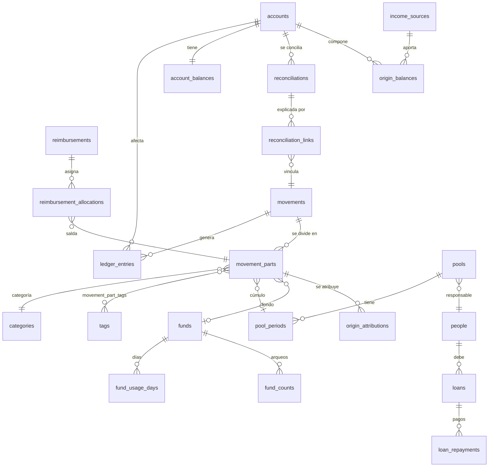

# 04 · Modelo de datos

> Estado: borrador v0.1 · 2026-10-25
> Depende de: `01-guia-programacion.md` (Event Sourcing, Room 3), `02-reglas-datos.md` (reglas E*/R*), `03-glosario.md` (nombres).

El modelo tiene **dos niveles**:

1. **Eventos** (tabla `events`): la verdad. Inmutables. Lo que el usuario declaró.
2. **Proyecciones** (resto de tablas): la interpretación. Derivadas, borrables y reconstruibles.

```
UseCase ──emite──► DomainEvent ──INSERT──► events
                         │
                         └─► Projectors (misma transacción) ──► tablas de proyección ──► UI
```

---

## 1. Tipos base

| Tipo | Kotlin | Almacenado como | Regla |
|---|---|---|---|
| Identificadores | `@JvmInline value class AccountId(val value: String)` (uno por entidad) | `TEXT` (UUID v4) | Generados en el caso de uso, **antes** de emitir el evento → el replay produce los mismos IDs |
| Dinero | `data class Money(val amountMinor: Long, val currency: CurrencyCode)` | dos columnas `*_minor INTEGER`, `currency TEXT` | Céntimos. Nunca `REAL` |
| Fecha del hecho | `LocalDate` | `TEXT` ISO-8601 (`2026-10-25`) | Ordenable como texto |
| Instante | `Instant` | `INTEGER` epoch millis UTC | |
| Enums | `enum class` | `TEXT` con el nombre (`"EXPENSE"`) | Nunca el ordinal (se rompe si se reordena) |

> **Por qué UUID y no autoincrement**: los IDs deben existir dentro del payload del evento. Si los genera la BD, un replay o una restauración podrían asignar IDs distintos y romper las referencias.

---

## 2. Tabla `events` (sobre del evento)

| Columna | Tipo | Nulo | Descripción |
|---|---|---|---|
| `sequence` | INTEGER PK | no | Orden global, monotónico, sin huecos (E6) |
| `event_id` | TEXT UNIQUE | no | UUID del evento |
| `type` | TEXT | no | Nombre del evento (`ExpenseRegistered`) |
| `schema_version` | INTEGER | no | Versión del payload (E4) |
| `aggregate_type` | TEXT | no | `ACCOUNT`, `MOVEMENT`, `POOL`, `FUND`, … |
| `aggregate_id` | TEXT | no | ID de la entidad afectada |
| `correlation_id` | TEXT | no | Agrupa eventos emitidos por una misma acción del usuario |
| `payload` | TEXT (JSON) | no | Datos del evento (kotlinx.serialization) |
| `occurred_on` | TEXT | no | Fecha del hecho en la vida real |
| `recorded_at` | INTEGER | no | Cuándo se registró |
| `app_version` | TEXT | no | `versionName` que lo escribió |
| `previous_hash` | TEXT | no | Hash del evento anterior (`"GENESIS"` en el primero) |
| `hash` | TEXT | no | `SHA-256(previous_hash ‖ type ‖ schema_version ‖ aggregate_id ‖ payload ‖ occurred_on ‖ recorded_at)` |

**Índices**: `(aggregate_type, aggregate_id, sequence)`, `(type)`, `(occurred_on)`.

**Triggers de inmutabilidad** (creados en la migración inicial):

```sql
CREATE TRIGGER events_no_update BEFORE UPDATE ON events
BEGIN SELECT RAISE(ABORT, 'events is append-only'); END;

CREATE TRIGGER events_no_delete BEFORE DELETE ON events
BEGIN SELECT RAISE(ABORT, 'events is append-only'); END;
```

> La única excepción es "Borrar todos mis datos", que elimina el **archivo** de BD completo, no filas.

**Historial de una entidad** = `SELECT * FROM events WHERE aggregate_type = ? AND aggregate_id = ? ORDER BY sequence`. Responde "¿qué le pasó a este movimiento?" sin tablas extra.

### Esqueleto en Kotlin

```kotlin
@Serializable
sealed interface DomainEvent {
    val aggregateId: String
    val occurredOn: LocalDate
}

@Serializable
@SerialName("ExpenseRegistered")
data class ExpenseRegistered(
    val movementId: MovementId,
    val accountId: AccountId,
    val total: Money,
    val parts: List<ExpensePartData>,
    val note: String?,
    override val occurredOn: LocalDate,
) : DomainEvent {
    override val aggregateId get() = movementId.value
}
```

---

## 3. Catálogo de eventos (payloads)

Convención: `?` = opcional. Todo `Money` va en la moneda de la cuenta involucrada.

### 3.1 Catálogos

| Evento | Payload |
|---|---|
| `AccountCreated` | `accountId, name, type (BANK/CASH/DIGITAL_WALLET), currency, color?, openingBalance: Money` |
| `AccountRenamed` | `accountId, name` |
| `AccountArchived` | `accountId` (requiere saldo 0) |
| `CategoryCreated` | `categoryId, name, icon, color, parentCategoryId?` |
| `CategoryRenamed` / `CategoryArchived` | `categoryId, name?` |
| `TagCreated` | `tagId, name, kind (PERSON/TOPIC), personId?` |
| `TagRenamed` / `TagArchived` | `tagId, name?` |
| `PersonCreated` | `personId, alias` |
| `PersonRenamed` / `PersonArchived` | `personId, alias?` |
| `IncomeSourceCreated` | `incomeSourceId, name, personId?` |

> `openingBalance` entra a la composición de origen como fuente especial `OPENING_BALANCE`.

### 3.2 Movimientos

| Evento | Payload |
|---|---|
| `IncomeRegistered` | `movementId, accountId, amount, incomeSourceId, categoryId?, note?` |
| `ExpenseRegistered` | `movementId, accountId, total, parts: List<ExpensePartData>, note?` |
| `TransferRegistered` | `movementId, fromAccountId, toAccountId, amount, fee?: FeeData, note?` |
| `MovementCorrected` | `movementId, snapshot: <payload completo del tipo original>, reason` |
| `MovementVoided` | `movementId, reason` |

```
ExpensePartData = partId, amount, categoryId, tagIds: List<TagId>,
                  poolId?, fundId?          // a lo sumo uno de los dos
FeeData         = amount, categoryId        // genera un gasto aparte en la cuenta origen
```

Reglas:
- **Todo gasto tiene ≥ 1 parte**. Un gasto simple es un gasto con una sola parte. Así, "dividir gasto" no necesita un evento propio: se registra con varias partes o se corrige con `MovementCorrected`.
- `Σ parts.amount == total` (validado en el caso de uso).
- `cúmulo` y `fondo` van **a nivel de parte**: en una boleta de mercado, S/ 110 pueden ir al cúmulo "Casa – mamá" y S/ 40 ser tuyos.
- Retiro o depósito **no se guardan**: se derivan de los tipos de cuenta (BANK→CASH = retiro).
- `MovementCorrected` guarda el **snapshot completo**, no un diff: el proyector reemplaza todo el estado del movimiento y es más difícil equivocarse.

### 3.3 Conciliación (en dos pasos)

La conciliación **no ajusta el saldo al registrarse**. Primero se registra y se muestra la diferencia; recién cuando decides la causa se registra (si hace falta) el ingreso o egreso no identificado.

```
1. Registrar      2. Investigar                       3. Resolver
──────────────    ───────────────────────────────     ─────────────────────────────
Saldo real del    • Registrar movimientos olvidados    • Diferencia restante = 0 → BALANCED
banco vs. saldo     (quedan vinculados)                • ≠ 0 → registrar ingreso/egreso
de la app         • Corregir movimientos mal anotados    no identificado + causa
(sin cambiar      • La diferencia restante se          • O cancelar (saldo real mal tipeado)
 saldos)            recalcula en vivo
Estado: OPEN                                           Estado: RESOLVED / CANCELLED
```

| Evento | Payload |
|---|---|
| `BalanceCheckRecorded` | `reconciliationId, accountId, realBalance, computedBalanceSnapshot, checkedAt` |
| `MovementLinkedToReconciliation` | `reconciliationId, movementId` (vincula un movimiento o corrección ya existente) |
| `ReconciliationResolved` | `reconciliationId, cause, adjustment?: AdjustmentData, note?` |
| `ReconciliationCancelled` | `reconciliationId, reason` |

```
AdjustmentData = movementId, direction (UNIDENTIFIED_INCOME / UNIDENTIFIED_EXPENSE), amount
cause          = BALANCED          // la diferencia quedó en 0 tras investigar
               | MISSING_RECORD    // se olvidó registrar algo (ya registrado y vinculado)
               | RECORDING_ERROR   // se registró mal (ya corregido y vinculado)
               | SUSPECTED_APP_ERROR
               | UNKNOWN           // no se encontró la causa → ajuste no identificado
```

Además, `IncomeRegistered`, `ExpenseRegistered`, `TransferRegistered`, `MovementCorrected` y `MovementVoided` aceptan un campo opcional `reconciliationId`. Es el que se completa cuando registras el movimiento olvidado **desde la pantalla de conciliación**.

**Cómo se calcula la diferencia restante** (determinista y reproducible):

```
saldoAppAlMomento = Σ asientos de la cuenta cuyo evento tiene recorded_at ≤ checkedAt
                  + Σ asientos de movimientos vinculados a esta conciliación
diferenciaRestante = realBalance − saldoAppAlMomento
```

- Se usa `recorded_at` (no `occurred_on`) para "congelar" lo que la app sabía al momento del chequeo. Los gastos que registres después por tu vida normal **no** alteran la conciliación.
- Los movimientos olvidados, aunque se registren después, **sí** cuentan porque están vinculados.
- `computedBalanceSnapshot` guarda lo que el código calculó en ese momento, solo como evidencia. La diferencia se recalcula siempre con las reglas vigentes.

Reglas:
- Una sola conciliación `OPEN` por cuenta a la vez.
- Solo `ReconciliationResolved` con `adjustment` genera un asiento `ADJUSTMENT`. Registrar o investigar **nunca** mueve saldos.
- `adjustment.amount` debe ser igual a `|diferenciaRestante|` al resolver.
- Ingreso no identificado → origen `UNKNOWN_ADJUSTMENT`. Egreso no identificado → se descuenta en proporción de las fuentes de la cuenta.

#### 3.3.1 Exportación de diagnóstico

Sirve para que **otra persona que usa la app en su propio teléfono** (por ejemplo, tu pareja) te envíe la información de una conciliación con diferencia, y puedas rastrear el error en tu equipo de desarrollo.

**Qué incluye el paquete** (`.fdiag`, ZIP):

| Archivo | Contenido | Para qué |
|---|---|---|
| `summary.pdf` | Resumen legible: cuenta, saldo real, saldo de la app, diferencia restante, causa, movimientos vinculados | Revisarlo a simple vista |
| `ledger.csv` | Asientos de la cuenta en el rango elegido, con saldo acumulado | Encontrar dónde se desvía el saldo |
| `events.jsonl` | Eventos crudos del alcance elegido (un evento por línea, con `sequence`, `schema_version`, `hash`) | **Reproducir** exactamente lo que pasó |
| `projections.json` | Lo que la app calculaba al exportar: saldo, `origin_balances`, estado de la conciliación | Comparar "código del que exporta" vs. "código actual" |
| `manifest.json` | Versión de la app, `projector_version` de cada proyector, versión de Android, fecha, alcance, campos anonimizados, hash del paquete | Saber con qué versión de reglas se generó |

**Alcance** (elegido por quien exporta):

| Alcance | Eventos incluidos | Cuándo usarlo |
|---|---|---|
| `RECONCILIATION` | Eventos de la cuenta hasta `checkedAt` + movimientos vinculados + transferencias que la tocan + catálogos referenciados | Por defecto, el paquete más pequeño |
| `ACCOUNT_HISTORY` | Toda la historia de la cuenta | Si el error parece antiguo |
| `FULL` | Todo el registro de eventos | Errores en trazabilidad de origen (dependen de todas las cuentas) |

**Anonimización** (opciones, activadas por defecto):
- Alias de personas, cuentas, conceptos y fuentes → seudónimos estables (`Person-1`, `Account-A`). El mismo alias siempre da el mismo seudónimo dentro del paquete.
- Notas libres → eliminadas.
- **Montos, fechas, IDs y orden no se alteran**: sin ellos no se puede reproducir el error.
- Si se anonimiza, la cadena de hashes no puede verificarse contra el original. El manifiesto guarda los hashes originales y marca los campos alterados, y el paquete lleva su propio hash de integridad.

**Del lado de quien recibe (modo diagnóstico)**:
- "Abrir paquete de diagnóstico" importa los eventos en una **base de datos aparte** (espacio de diagnóstico), **nunca** en tus datos reales.
- Re-proyecta con el código actual y muestra un **reporte de diferencias**: saldo exportado vs. saldo recalculado, asiento por asiento, indicando el primer `sequence` donde divergen.
- El espacio de diagnóstico es de solo lectura y se puede borrar en cualquier momento.

#### 3.3.2 Diccionario de seudónimos (paso posterior a la auditoría)

El paquete de diagnóstico y el **diccionario** que revela los seudónimos son **dos archivos distintos**, que se generan en momentos distintos. El diccionario solo se extrae si la auditoría encontró una diferencia y hace falta saber exactamente a qué corresponde.

```
Quien exporta (p. ej. tu pareja)            Quien audita (tú)
────────────────────────────────            ──────────────────────────────────────
1. Exporta paquete anonimizado ───────────► 2. Abre en espacio de diagnóstico
   (.fdiag)                                    y re-proyecta → reporte de diferencias
                                               "diverge en #482: Account-A, Person-1"
                                            3. Genera una solicitud de diccionario
                                    ◄────────  (lista de seudónimos y eventos)
4. Desde la MISMA conciliación,
   exporta el diccionario (.fkey) ────────► 5. Aplica el diccionario al espacio
   parcial o completo, con contraseña          de diagnóstico → ve nombres reales
```

**Cómo se generan los seudónimos.** Al exportar, el evento guarda la tabla `seudónimo → ID de entidad` (no el alias). El alias real se resuelve después a partir de los eventos **hasta el `sequence` de la exportación**. Así:
- el diccionario siempre corresponde a lo que había en el paquete, aunque luego se renombre una cuenta o persona;
- no se duplican nombres en el registro de eventos;
- se puede extraer el diccionario días después, sin haber guardado nada aparte.

**Contenido del diccionario** (`.fkey`, JSON cifrado):

| Campo | Contenido |
|---|---|
| `exportId`, `packageHash` | Vínculo con el paquete exacto; si no coinciden, no se puede aplicar |
| `entries` | `seudónimo → alias real` (solo los incluidos) |
| `notes` | Notas originales de eventos específicos, solo si se eligieron |
| `scope` | `PARTIAL` (solo lo solicitado) o `FULL` |

**Alcance del diccionario**:
- `PARTIAL` (por defecto): solo los seudónimos y notas de la **solicitud** generada por el reporte de diferencias. Revela lo mínimo necesario.
- `FULL`: todos los seudónimos del paquete.

**Solicitud de diccionario**: el reporte de diferencias genera una lista corta (o un código para copiar y enviar por chat) con los seudónimos y `eventId` involucrados. Quien exporta la carga en su conciliación, ve exactamente qué se revelará y lo confirma.

**Aplicación**: el diccionario se guarda **solo dentro del espacio de diagnóstico**. Al borrar el espacio, se borra el diccionario.

| Evento (en el registro de quien exporta) | Payload |
|---|---|
| `DiagnosticExportCreated` | `exportId, reconciliationId?, scope, anonymized: Boolean, exportedUpToSequence, pseudonymMap: Map<String, EntityRef>, eventCount, packageHash` |
| `DiagnosticDictionaryExported` | `dictionaryId, exportId, scope (PARTIAL/FULL), revealedPseudonyms: List<String>, revealedNoteEventIds: List<String>` |

`EntityRef = entityType (ACCOUNT/PERSON/TAG/CATEGORY/INCOME_SOURCE/POOL/FUND), entityId`.

### 3.4 Cúmulos y reembolsos

| Evento | Payload |
|---|---|
| `ReimbursementPoolCreated` | `poolId, name, responsiblePersonId, kind (PERMANENT/EVENT), defaultCategoryId?, defaultTagIds` |
| `ReimbursementPoolRenamed` / `ReimbursementPoolArchived` | `poolId, name?` |
| `SettlementStatementGenerated` | `statementId, poolId, periodId, partIds, pendingTotal, format (IMAGE/PDF)` |
| `ReimbursementReceived` | `reimbursementId, personId, accountId, amount, strategy (OLDEST_FIRST/MANUAL), allocations: List<AllocationData>, note?` |

```
AllocationData = partId, amount
```

Reglas:
- Al generar la rendición de un cúmulo `PERMANENT`, el periodo pasa a `STATEMENT_SENT` y se abre uno nuevo. Los gastos nuevos caen en el periodo nuevo.
- Las asignaciones se calculan **en el caso de uso** y se guardan en el evento, aunque la estrategia sea `OLDEST_FIRST`. Así, si mañana cambia el algoritmo, el pasado no cambia.
- "Periodo saldado" **no es un evento**: es un estado derivado (pendiente = 0). Regla general: **un hecho derivable no se guarda como evento**.

### 3.5 Deudas sueltas

| Evento | Payload |
|---|---|
| `LoanGranted` | `loanId, personId, accountId, amount, note?` (sale dinero, **no es gasto**) |
| `LoanRepaymentReceived` | `repaymentId, loanId, accountId, amount` (entra dinero, **no es ingreso**) |

### 3.6 Fondos

| Evento | Payload |
|---|---|
| `FundCreated` | `fundId, name, consumptionMode (DETAILED/DAILY_ESTIMATE/NONE), dailyEstimate?, startsOn, endsOn?` |
| `FundToppedUp` | `fundId, amount, linkedIncomeMovementId?` |
| `UsageDayMarked` / `UsageDayUnmarked` | `fundId, day` |
| `FundCounted` | `fundId, declaredRemaining, untrackedSpend?: UntrackedSpendData` |
| `FundClosed` | `fundId, remainderPolicy (RELEASE_TO_AVAILABLE/ROLL_OVER), rollOverToFundId?` |

```
UntrackedSpendData = accountId, categoryId, amount
```

**Punto importante del arqueo.** Si no registraste cada pasaje, ese dinero sí salió de una cuenta real (normalmente Efectivo), pero la app no lo sabe. Al arquear:

```
gastadoNoRegistrado = asignado − gastadoDetallado − restanteDeclarado
```

Si es mayor que 0, el arqueo **genera un gasto implícito** (`untrackedSpend`) en la cuenta que elijas. Sin eso, el saldo de Efectivo quedaría inflado y la conciliación mostraría una diferencia "fantasma".

- La recarga de mamá para pasajes = `IncomeRegistered` (fuente Mamá) + `FundToppedUp` con `linkedIncomeMovementId`, emitidos juntos con el mismo `correlation_id`.
- También se puede apartar dinero que ya tenías (`FundToppedUp` sin ingreso vinculado).

### 3.7 Ingresos esperados

| Evento | Payload |
|---|---|
| `ExpectedIncomeScheduled` | `expectedIncomeId, incomeSourceId, accountId, estimatedAmount, expectedFrom, expectedTo, repeatsMonthly: Boolean` |
| `ExpectedIncomeConfirmed` | `expectedIncomeId, incomeMovementId` |
| `ExpectedIncomeCancelled` | `expectedIncomeId, reason?` |

`OVERDUE` es derivado (hoy > `expectedTo` sin confirmar). Si `repeatsMonthly`, al confirmar se programa el siguiente con el mismo rango de días.

### 3.8 Auditoría técnica

| Evento | Payload |
|---|---|
| `BackupCreated` | `backupId, eventCount, lastHash` |
| `BackupRestored` | `backupId, eventCount` |
| `ProjectionsRebuilt` | `projectorVersions: Map<String, Int>, reason` |

---

## 4. Tablas de proyección

Todas incluyen `last_sequence` (último evento aplicado) cuando aplica. Todas se pueden truncar y reconstruir.

### 4.1 Diagrama de relaciones



### 4.2 Catálogos

| Tabla | Columnas |
|---|---|
| `accounts` | `id PK, name, type, currency, color, is_archived, created_on` |
| `categories` | `id PK, name, icon, color, parent_id FK?, is_archived` |
| `tags` | `id PK, name, kind, person_id FK?, is_archived` |
| `people` | `id PK, alias, is_archived` |
| `income_sources` | `id PK, name, kind (REGULAR/OPENING_BALANCE/UNKNOWN_ADJUSTMENT/REIMBURSEMENT/LOAN_REPAYMENT), person_id FK?` |

### 4.3 Movimientos y libro contable

| Tabla | Columnas | Notas |
|---|---|---|
| `movements` | `id PK, type, account_id FK, counter_account_id FK?, amount_minor, currency, income_source_id FK?, person_id FK?, note, occurred_on, status (ACTIVE/VOIDED), revision INT, last_sequence` | `type`: `INCOME, EXPENSE, TRANSFER, REIMBURSEMENT, LOAN_DISBURSEMENT, LOAN_REPAYMENT, ADJUSTMENT, FUND_UNTRACKED_SPEND`. `revision` crece con cada corrección |
| `movement_parts` | `id PK, movement_id FK, amount_minor, category_id FK, pool_id FK?, pool_period_id FK?, fund_id FK?, reimbursed_minor, reimbursement_status` | Solo para gastos |
| `movement_part_tags` | `part_id FK, tag_id FK` · PK compuesta | M:N |
| `ledger_entries` | `id PK, sequence, movement_id FK, account_id FK, delta_minor (±), entry_kind, occurred_on, is_voided` | **Corazón contable**: cada cambio de saldo es una fila. Transferencia = 2 filas (−origen, +destino) |
| `account_balances` | `account_id PK, balance_minor, last_sequence` | Caché de `Σ delta` no anulados |

`entry_kind`: `OPENING, INCOME, EXPENSE, FEE, TRANSFER_OUT, TRANSFER_IN, REIMBURSEMENT_IN, LOAN_OUT, LOAN_IN, ADJUSTMENT`.

> **Saldo a una fecha**: `SELECT SUM(delta_minor) FROM ledger_entries WHERE account_id = ? AND occurred_on <= ? AND is_voided = 0`.

### 4.4 Cúmulos, reembolsos y deudas

| Tabla | Columnas |
|---|---|
| `pools` | `id PK, name, responsible_person_id FK, kind, default_category_id?, is_archived` |
| `pool_periods` | `id PK, pool_id FK, opened_on, closed_on?, status (OPEN/STATEMENT_SENT/SETTLED), statement_id?, total_minor, reimbursed_minor` |
| `settlement_statements` | `id PK, pool_id FK, period_id FK, pending_total_minor, format, generated_on` |
| `reimbursements` | `id PK, person_id FK, movement_id FK, amount_minor, strategy, occurred_on` |
| `reimbursement_allocations` | `reimbursement_id FK, part_id FK, amount_minor` · PK compuesta |
| `loans` | `id PK, person_id FK, movement_id FK, principal_minor, repaid_minor, status (OPEN/REPAID), occurred_on` |
| `loan_repayments` | `id PK, loan_id FK, movement_id FK, amount_minor, occurred_on` |

### 4.5 Fondos e ingresos esperados

| Tabla | Columnas |
|---|---|
| `funds` | `id PK, name, consumption_mode, daily_estimate_minor?, starts_on, ends_on?, allocated_minor, detailed_spent_minor, untracked_spent_minor, status (ACTIVE/CLOSED), remainder_policy?` |
| `fund_usage_days` | `fund_id FK, day` · PK compuesta |
| `fund_counts` | `id PK, fund_id FK, declared_remaining_minor, estimated_spent_minor, real_spent_minor, deviation_minor, occurred_on` |
| `expected_incomes` | `id PK, income_source_id FK, account_id FK, estimated_minor, expected_from, expected_to, repeats_monthly, status, confirmed_movement_id?` |

### 4.6 Trazabilidad de origen y conciliación

| Tabla | Columnas | Notas |
|---|---|---|
| `origin_balances` | `account_id FK, income_source_id FK, amount_minor` · PK compuesta | Cuánto del saldo de cada cuenta viene de cada fuente (en **montos**, no %) |
| `origin_attributions` | `part_id FK (o movement_id), income_source_id FK, amount_minor` | De dónde salió cada gasto |
| `reconciliations` | `id PK, account_id FK, real_minor, snapshot_computed_minor, current_computed_minor, remaining_difference_minor, status (OPEN/RESOLVED/CANCELLED), cause?, adjustment_movement_id FK?, adjustment_minor?, checked_at, resolved_at?, needs_review` | Historial "vida real vs. código" |
| `reconciliation_links` | `reconciliation_id FK, movement_id FK` · PK compuesta | Movimientos que explicaron la diferencia |

### 4.7 Control

| Tabla | Columnas |
|---|---|
| `projection_state` | `projector_name PK, projector_version, last_sequence, rebuilt_at` |

---

## 5. Reglas derivadas (proyectores)

### 5.1 Trazabilidad de origen (por proporción)
Por cada asiento del libro, en orden de `sequence`:

| Asiento | Efecto en `origin_balances` |
|---|---|
| `OPENING` / `INCOME` | `+monto` a (cuenta, fuente del ingreso) |
| `REIMBURSEMENT_IN` / `LOAN_IN` | `+monto` a (cuenta, fuente especial `REIMBURSEMENT`/`LOAN_REPAYMENT` de esa persona) |
| `ADJUSTMENT` (+) | `+monto` a (cuenta, `UNKNOWN_ADJUSTMENT`) |
| `EXPENSE` / `FEE` / `LOAN_OUT` / `ADJUSTMENT` (−) | Se descuenta de cada fuente de la cuenta **en proporción** a su monto actual → se guarda en `origin_attributions` |
| `TRANSFER_OUT` → `TRANSFER_IN` | Se descuenta del origen en proporción y **la misma mezcla** se suma al destino |

Redondeo: método del **mayor residuo** (la suma de las porciones siempre es igual al monto exacto, al céntimo).

Si una cuenta queda en negativo (por error de registro), el faltante se asigna a `UNKNOWN_ADJUSTMENT` y la UI avisa.

### 5.2 Asignación de reembolsos (`OLDEST_FIRST`)
Partes pendientes del cúmulo/persona ordenadas por `occurred_on`, luego `sequence`; se salda cada una hasta agotar el monto. Si sobra dinero, el caso de uso rechaza o pide confirmar "saldo a favor" (decisión pendiente, §7).

### 5.3 Correcciones y anulaciones
- `MovementVoided` → `movements.status = VOIDED`, sus `ledger_entries.is_voided = 1`.
- `MovementCorrected` → anula los asientos viejos y crea los nuevos con el snapshot.
- Como la composición de origen depende del **orden**, una corrección de un movimiento antiguo dispara la **re-proyección de `origin_*` desde ese `sequence`** (o completa, en el MVP, por simplicidad).

### 5.4 Conciliación como detector de errores de código
Tras cada re-proyección (por ejemplo, después de corregir un bug y actualizar la app), el proyector recalcula `current_computed_minor` de **todas** las conciliaciones, incluidas las resueltas:

| Caso | Interpretación | Acción en la app |
|---|---|---|
| Resuelta con ajuste y la diferencia recalculada (sin contar el ajuste) sigue igual al ajuste | El error era de registro / desconocido | Nada |
| Resuelta con ajuste y la diferencia recalculada **cambió** | El código anterior calculaba mal; el ajuste ya no corresponde | `needs_review = 1`; la app avisa y sugiere anular el ajuste (`MovementVoided`, vinculado) |
| Resuelta `BALANCED` y ahora aparece diferencia | El código nuevo introdujo un error | `needs_review = 1` + aviso en herramientas de desarrollador |

Así queda evidencia comparable de "vida real (saldo del banco) vs. código (saldo calculado con cada versión de reglas)".

### 5.5 Fórmulas de la pantalla principal

| Indicador | Fórmula |
|---|---|
| Saldo en cuentas | `Σ account_balances.balance_minor` |
| Apartado en fondos | `Σ (allocated − detailed_spent − untracked_spent)` de fondos `ACTIVE` |
| Disponible libre | Saldo en cuentas − Apartado en fondos |
| Por cobrar | `Σ (parte.amount − parte.reimbursed)` de partes con cúmulo + `Σ (principal − repaid)` de deudas `OPEN` |

### 5.6 Gasto real del mes
- **Gasto propio** = partes sin cúmulo + **porción pendiente** de las partes con cúmulo (mientras no te paguen, cuenta como gasto).
- **Gasto por otros** = partes con cúmulo (total, reembolsado, pendiente).
- `REIMBURSEMENT`, `LOAN_*` y `TRANSFER` **nunca** cuentan como ingreso ni gasto.
- Los ingresos/egresos **no identificados** (`ADJUSTMENT`) se muestran en una línea propia ("No identificado"), separada de las categorías, para que no distorsionen la distribución pero sí sean visibles.
- La distribución por categoría suma el 100% (1 categoría por parte). Los conceptos son solo filtros.

---

## 6. Ejemplo completo (traza de eventos)

```
#1  AccountCreated        BBVA, BANK, opening S/ 1,000
#2  AccountCreated        BCP,  BANK, opening S/ 0
#3  AccountCreated        Efectivo, CASH, opening S/ 0
#4  PersonCreated         "Mamá"
#5  ReimbursementPoolCreated "Perros – mamá", responsable Mamá, PERMANENT
#6  ExpenseRegistered     BBVA S/ 120, parte: Comida mascotas, cúmulo Perros
#7  IncomeRegistered      BCP S/ 50, fuente Mamá            ┐ correlation c1
#8  FundToppedUp          Pasajes S/ 50, linked #7          ┘
#9  TransferRegistered    BBVA → Efectivo S/ 100 (retiro)
#10 ExpenseRegistered     Efectivo S/ 5, Transporte, fondo Pasajes
#11 ReimbursementReceived Mamá → BCP S/ 120, alloc: parte de #6 = 120
```

Resultado: BBVA 780 · BCP 170 · Efectivo 95 · Apartado Pasajes 45 · Por cobrar 0 · Disponible libre 1,000.

---

## 7. Decisiones tomadas (2026-10-25)

| # | Pregunta | Decisión |
|---|---|---|
| D1 | Si el reembolso **excede** lo pendiente | Se rechaza y se pide corregir el monto (MVP) |
| D2 | Gastos recurrentes dentro de cúmulos | Pasa a v2 (plantillas de gasto) |
| D3 | Multimoneda | Solo PEN en el MVP; el modelo ya guarda `currency` |
| D4 | Re-proyección al corregir | Total en el MVP; parcial más adelante |
| D5 | Subcategorías | Sí, un nivel (`parent_id`) |
| D6 | Conciliación | En dos pasos: registrar y visualizar la diferencia sin tocar saldos; ajustar con ingreso/egreso no identificado solo al resolver, con causa (§3.3) |
| D7 | Exportación de diagnóstico | Paquete `.fdiag` desde una conciliación, anonimizado por defecto, que se abre en un espacio de diagnóstico separado y re-proyecta para encontrar la divergencia (§3.3.1) |
| D8 | Diccionario de seudónimos | Archivo separado `.fkey`, extraído desde la misma conciliación **después** de la auditoría, parcial por defecto y con contraseña (§3.3.2) |
