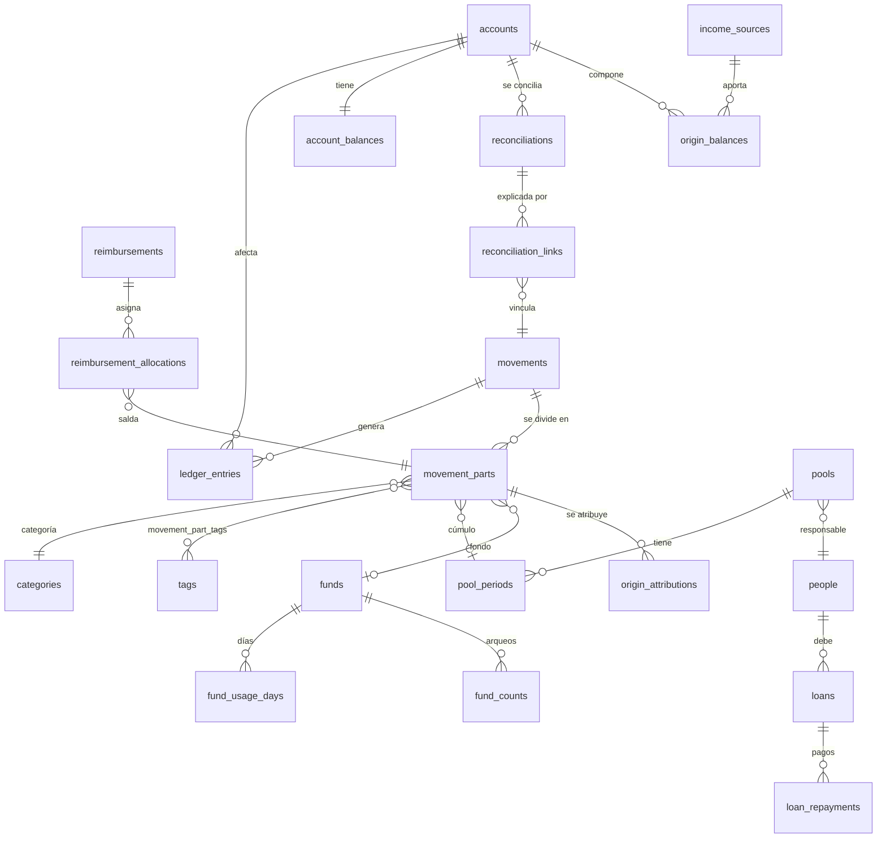

# 04 · Modelo de datos

> Estado: borrador v0.1 · 2026-10-25
> Depende de: `01-guia-programacion.md` (Event Sourcing, Room 3), `02-reglas-datos.md` (reglas E*/R*), `03-glosario.md` (nombres).

El modelo tiene **dos niveles**:

1. **Eventos** (tabla `events`): la verdad. Inmutables. Lo que el usuario declaró.
2. **Proyecciones** (resto de tablas): la interpretación. Derivadas, borrables y reconstruibles.

```
UseCase ──emite──► DomainEvent ──INSERT──► events
                         │
                         └─► Projectors (misma transacción) ──► tablas de proyección ──► UI
```

---

## 1. Tipos base

| Tipo | Kotlin | Almacenado como | Regla |
|---|---|---|---|
| Identificadores | `@JvmInline value class AccountId(val value: String)` (uno por entidad) | `TEXT` (UUID v4) | Generados en el caso de uso, **antes** de emitir el evento → el replay produce los mismos IDs |
| Dinero | `data class Money(val amountMinor: Long, val currency: CurrencyCode)` | dos columnas `*_minor INTEGER`, `currency TEXT` | Céntimos. Nunca `REAL` |
| Fecha del hecho | `LocalDate` | `TEXT` ISO-8601 (`2026-10-25`) | Ordenable como texto |
| Instante | `Instant` | `INTEGER` epoch millis UTC | |
| Enums | `enum class` | `TEXT` con el nombre (`"EXPENSE"`) | Nunca el ordinal (se rompe si se reordena) |

> **Por qué UUID y no autoincrement**: los IDs deben existir dentro del payload del evento. Si los genera la BD, un replay o una restauración podrían asignar IDs distintos y romper las referencias.

---

## 2. Tabla `events` (sobre del evento)

| Columna | Tipo | Nulo | Descripción |
|---|---|---|---|
| `sequence` | INTEGER PK | no | Orden global, monotónico, sin huecos (E6) |
| `event_id` | TEXT UNIQUE | no | UUID del evento |
| `type` | TEXT | no | Nombre del evento (`ExpenseRegistered`) |
| `schema_version` | INTEGER | no | Versión del payload (E4) |
| `aggregate_type` | TEXT | no | `ACCOUNT`, `MOVEMENT`, `POOL`, `FUND`, … |
| `aggregate_id` | TEXT | no | ID de la entidad afectada |
| `correlation_id` | TEXT | no | Agrupa eventos emitidos por una misma acción del usuario |
| `payload` | TEXT (JSON) | no | Datos del evento (kotlinx.serialization) |
| `occurred_on` | TEXT | no | Fecha del hecho en la vida real |
| `recorded_at` | INTEGER | no | Cuándo se registró |
| `app_version` | TEXT | no | `versionName` que lo escribió |
| `previous_hash` | TEXT | no | Hash del evento anterior (`"GENESIS"` en el primero) |
| `hash` | TEXT | no | `SHA-256(previous_hash ‖ event_id ‖ type ‖ schema_version ‖ aggregate_type ‖ aggregate_id ‖ correlation_id ‖ payload ‖ occurred_on ‖ recorded_at ‖ app_version)`: todas las columnas salvo `sequence` y `hash`; `‖` = separador `U+001F`, y `payload` es el texto exacto guardado |

**Índices**: `(aggregate_type, aggregate_id, sequence)`, `(type)`, `(occurred_on)`.

**Triggers de inmutabilidad** (creados en la migración inicial):

```sql
CREATE TRIGGER events_no_update BEFORE UPDATE ON events
BEGIN SELECT RAISE(ABORT, 'events is append-only'); END;

CREATE TRIGGER events_no_delete BEFORE DELETE ON events
BEGIN SELECT RAISE(ABORT, 'events is append-only'); END;
```

> La única excepción es "Borrar todos mis datos", que elimina el **archivo** de BD completo, no filas.

**Historial de una entidad** = `SELECT * FROM events WHERE aggregate_type = ? AND aggregate_id = ? ORDER BY sequence`. Responde "¿qué le pasó a este movimiento?" sin tablas extra.

### Esqueleto en Kotlin

```kotlin
@Serializable
sealed interface DomainEvent {
    val aggregateId: String
    val occurredOn: LocalDate
}

@Serializable
@SerialName("ExpenseRegistered")
data class ExpenseRegistered(
    val movementId: MovementId,
    val accountId: AccountId,
    val total: Money,
    val parts: List<ExpensePartData>,
    val note: String?,
    override val occurredOn: LocalDate,
) : DomainEvent {
    override val aggregateId get() = movementId.value
}
```

---

## 3. Catálogo de eventos (payloads)

Convención: `?` = opcional. Todo `Money` va en la moneda de la cuenta involucrada.

### 3.1 Catálogos

| Evento | Payload |
|---|---|
| `AccountCreated` | `accountId, name, type (BANK/CASH/DIGITAL_WALLET), currency, color?, openingBalance: Money` |
| `AccountRenamed` | `accountId, name` |
| `AccountArchived` | `accountId` (requiere saldo 0) |
| `CategoryCreated` | `categoryId, name, icon, color, parentCategoryId?` |
| `CategoryRenamed` / `CategoryArchived` | `categoryId, name?` |
| `TagCreated` | `tagId, name, kind (PERSON/TOPIC), personId?` |
| `TagRenamed` / `TagArchived` | `tagId, name?` |
| `PersonCreated` | `personId, alias` |
| `PersonRenamed` / `PersonArchived` | `personId, alias?` |
| `IncomeSourceCreated` | `incomeSourceId, name, personId?` |

> `openingBalance` entra a la composición de origen como fuente especial `OPENING_BALANCE`.

### 3.2 Movimientos

| Evento | Payload |
|---|---|
| `IncomeRegistered` | `movementId, accountId, amount, incomeSourceId, reconciliationId?, note?` (sin categoría, D13) |
| `ExpenseRegistered` | `movementId, accountId, total, parts: List<ExpensePartData>, note?` |
| `TransferRegistered` | `movementId, fromAccountId, toAccountId, amount, fee?: FeeData, note?` |
| `MovementCorrected` | `movementId, snapshot: <payload completo del tipo original>, reason` |
| `MovementVoided` | `movementId, reason` |

```
ExpensePartData = partId, amount, categoryId, tagIds: List<TagId>,
                  poolId?, fundId?          // a lo sumo uno de los dos
FeeData         = amount, categoryId        // genera un gasto aparte en la cuenta origen
```

Reglas:
- **Todo gasto tiene ≥ 1 parte**. Un gasto simple es un gasto con una sola parte. Así, "dividir gasto" no necesita un evento propio: se registra con varias partes o se corrige con `MovementCorrected`.
- `Σ parts.amount == total` (validado en el caso de uso).
- `cúmulo` y `fondo` van **a nivel de parte**: en una boleta de mercado, S/ 110 pueden ir al cúmulo "Casa – mamá" y S/ 40 ser tuyos.
- Retiro o depósito **no se guardan**: se derivan de los tipos de cuenta (BANK→CASH = retiro).
- Una transferencia **no se anula ni se corrige** (`MovementVoided` y `MovementCorrected` se rechazan para `TRANSFER`): un error se deshace registrando otra transferencia en sentido contrario y, si hace falta, la correcta. La comisión de la original sigue siendo gasto (D12).
- `MovementCorrected` guarda el **snapshot completo**, no un diff: el proyector reemplaza todo el estado del movimiento y es más difícil equivocarse.

### 3.3 Conciliación (en dos pasos)

La conciliación **no ajusta el saldo al registrarse**. Primero se registra y se muestra la diferencia; recién cuando decides la causa se registra (si hace falta) el ingreso o egreso no identificado.

```
1. Registrar      2. Investigar                       3. Resolver
──────────────    ───────────────────────────────     ─────────────────────────────
Saldo real del    • Registrar movimientos olvidados    • Diferencia restante = 0 → BALANCED
banco vs. saldo     (quedan vinculados)                • ≠ 0 → registrar ingreso/egreso
de la app         • Corregir movimientos mal anotados    no identificado + causa
(sin cambiar      • La diferencia restante se          • O cancelar (saldo real mal tipeado)
 saldos)            recalcula en vivo
Estado: OPEN                                           Estado: RESOLVED / CANCELLED
```

| Evento | Payload |
|---|---|
| `BalanceCheckRecorded` | `reconciliationId, accountId, realBalance, computedBalanceSnapshot` (`checkedAt` es el `recorded_at` del evento, no se edita; `realBalance` puede ser 0 o negativo, D34) |
| `MovementLinkedToReconciliation` | `reconciliationId, movementId` (vincula un movimiento o corrección ya existente) |
| `ReconciliationResolved` | `reconciliationId, cause, adjustment?: AdjustmentData, note?` |
| `ReconciliationCancelled` | `reconciliationId, reason` |

```
AdjustmentData = movementId, direction (UNIDENTIFIED_INCOME / UNIDENTIFIED_EXPENSE), amount
cause          = BALANCED          // la diferencia quedó en 0 tras investigar
               | MISSING_RECORD    // se olvidó registrar algo (ya registrado y vinculado)
               | RECORDING_ERROR   // se registró mal (ya corregido y vinculado)
               | SUSPECTED_APP_ERROR
               | UNKNOWN           // no se encontró la causa → ajuste no identificado
```

Además, `IncomeRegistered`, `ExpenseRegistered`, `TransferRegistered`, `MovementCorrected` y `MovementVoided` aceptan un campo opcional `reconciliationId`. Es el que se completa cuando registras el movimiento olvidado **desde la pantalla de conciliación**.

**Cómo se calcula la diferencia restante** (determinista y reproducible):

```
saldoAppAlMomento = Σ asientos de la cuenta con sequence ≤ sequence del chequeo y no anulados con voided_sequence ≤ ese corte,
                    SIN los de movimientos vinculados a esta conciliación
                  + Σ asientos vigentes de los movimientos vinculados
diferenciaRestante = realBalance − saldoAppAlMomento
```

- Se corta por `sequence` del `BalanceCheckRecorded` (no por `occurred_on` ni por reloj) para "congelar" lo que la app sabía al momento del chequeo. Los gastos que registres después por tu vida normal **no** alteran la conciliación, y una anulación o corrección posterior no vinculada tampoco (`ledger_entries.voided_sequence`, D30).
- Los movimientos olvidados, aunque se registren después, **sí** cuentan porque están vinculados. Una corrección vinculada **reemplaza** el asiento viejo: cuenta el asiento vigente, no ambos (D30).
- `current_computed_minor` y `remaining_difference_minor` no se guardan: se calculan al consultar.
- `computedBalanceSnapshot` guarda lo que el código calculó en ese momento, solo como evidencia. La diferencia se recalcula siempre con las reglas vigentes.

Reglas:
- Una sola conciliación `OPEN` por cuenta a la vez.
- Solo `ReconciliationResolved` con `adjustment` genera un asiento `ADJUSTMENT`. Registrar o investigar **nunca** mueve saldos.
- `adjustment.amount` debe ser igual a `|diferenciaRestante|` al resolver; la dirección sale del signo (positivo = `UNIDENTIFIED_INCOME`). El movimiento `ADJUSTMENT` lleva la fecha de la resolución (D33).
- Causa × diferencia: `BALANCED`, `MISSING_RECORD` y `RECORDING_ERROR` exigen diferencia 0; `UNKNOWN` y `SUSPECTED_APP_ERROR` exigen ≠ 0. Con diferencia 0 no se crea ajuste.
- Cancelar exige motivo, deja los vínculos sin efecto y no deja ajustes. Archivar una cuenta con conciliación `OPEN` se rechaza. El movimiento `ADJUSTMENT` se puede anular pero no corregir.
- Ingreso no identificado → origen `UNKNOWN_ADJUSTMENT`. Egreso no identificado → se descuenta en proporción de las fuentes de la cuenta.

#### 3.3.1 Exportación de diagnóstico

Sirve para que **otra persona que usa la app en su propio teléfono** (por ejemplo, tu pareja) te envíe la información de una conciliación con diferencia, y puedas rastrear el error en tu equipo de desarrollo.

**Qué incluye el paquete** (`.fdiag`, ZIP):

| Archivo | Contenido | Para qué |
|---|---|---|
| `summary.pdf` | Resumen legible: cuenta, saldo real, saldo de la app, diferencia restante, causa, movimientos vinculados | Revisarlo a simple vista |
| `ledger.csv` | Asientos de la cuenta en el rango elegido, con saldo acumulado | Encontrar dónde se desvía el saldo |
| `events.jsonl` | Eventos crudos del alcance elegido (un evento por línea, con `sequence`, `schema_version`, `hash`) | **Reproducir** exactamente lo que pasó |
| `projections.json` | Lo que la app calculaba al exportar: saldo, `origin_balances`, estado de la conciliación | Comparar "código del que exporta" vs. "código actual" |
| `manifest.json` | Versión de la app, `projector_version` de cada proyector, versión de Android, fecha, alcance, campos anonimizados, hash del paquete | Saber con qué versión de reglas se generó |

**Alcance** (elegido por quien exporta):

| Alcance | Eventos incluidos | Cuándo usarlo |
|---|---|---|
| `RECONCILIATION` | Eventos de la cuenta hasta `checkedAt` + movimientos vinculados + transferencias que la tocan + catálogos referenciados | Por defecto, el paquete más pequeño |
| `ACCOUNT_HISTORY` | Toda la historia de la cuenta | Si el error parece antiguo |
| `FULL` | Todo el registro de eventos, salvo los de auditoría de respaldos y diagnósticos | Errores en trazabilidad de origen (dependen de todas las cuentas) |

**Anonimización** (opciones, activadas por defecto), por **lista permitida** (D52):
- Viajan tal cual los IDs, montos, fechas, tipos y enums. Todo texto libre (un `String` plano en el payload) se clasifica en una tabla explícita como `PSEUDONYM` o `REMOVE`; un test falla si aparece un `String` sin clasificar. Un tercer valor, `KEEP`, solo cubre textos que no son de la persona (códigos como la razón de un replay, colores e íconos, hashes e identificadores de la auditoría).
- `PSEUDONYM`: alias de personas, cuentas, categorías, conceptos, fuentes, cúmulos y fondos → seudónimos estables (`Person-1`, `Account-A`). El seudónimo es de la **entidad**, no del texto: renombrar una cuenta conserva su seudónimo y dos entidades con el mismo alias reciben seudónimos distintos. Las cuentas llevan letras (`Account-A`) y el resto números por clase (`Person-1`, `Category-1`, `Tag-1`, `Source-1`, `Pool-1`, `Fund-1`), en orden de aparición.
- `REMOVE`: notas y motivos libres (`note`, `reason`). Un campo obligatorio de texto que se elimina queda como `"[removed]"`; los opcionales quedan `null`.
- **Montos, fechas, IDs y orden no se alteran**: sin ellos no se puede reproducir el error.
- Si se anonimiza, la cadena de hashes no puede verificarse contra el original. El manifiesto guarda los hashes originales y marca los campos alterados.

**Integridad y determinismo** (D54):
- El ZIP lleva exactamente cinco entradas, en este orden: `summary.pdf`, `ledger.csv`, `events.jsonl`, `projections.json`, `manifest.json`; marcas de tiempo fijas (1980-01-01) para que el mismo contenido dé el mismo ZIP.
- `manifest.json` lleva `contentHash` = SHA-256 de las otras cuatro entradas en ese orden (cada una entra con su nombre, un 0 y su largo en 8 bytes, para que no se confundan). `packageHash` (el del evento `DiagnosticExportCreated`) = SHA-256 del ZIP en claro.
- Con contraseña, el ZIP completo va dentro del contenedor cifrado (`EncryptedContainer`); el `packageHash` sigue siendo el del ZIP en claro.
- `projections.json` guarda lo que la app calculaba al exportar: saldos por cuenta, asientos de la cuenta, estado de la conciliación y la versión de cada proyector; `origin_balances` solo con alcance `FULL` y como dato secundario.
- `ledger.csv` aplica las mismas defensas de inyección de fórmulas que la exportación de reportes (RX3).

**Del lado de quien recibe (modo diagnóstico)**:
- "Abrir paquete de diagnóstico" importa los eventos en una **base de datos aparte** (espacio de diagnóstico), **nunca** en tus datos reales.
- Re-proyecta con el código actual y muestra un **reporte de diferencias** (`DivergenceReport`): saldo exportado vs. saldo recalculado, asiento por asiento, indicando el primer `sequence` donde divergen. Re-proyectar no agrega eventos.
- El espacio de diagnóstico es una segunda base con el mismo esquema, cifrada con clave propia (D51). Ningún caso de uso de la app real escribe en él salvo el importador, el aplicador de diccionario y el borrado; se puede borrar en cualquier momento. Hay un solo paquete abierto a la vez.

#### 3.3.2 Diccionario de seudónimos (paso posterior a la auditoría)

El paquete de diagnóstico y el **diccionario** que revela los seudónimos son **dos archivos distintos**, que se generan en momentos distintos. El diccionario solo se extrae si la auditoría encontró una diferencia y hace falta saber exactamente a qué corresponde.

```
Quien exporta (p. ej. tu pareja)            Quien audita (tú)
────────────────────────────────            ──────────────────────────────────────
1. Exporta paquete anonimizado ───────────► 2. Abre en espacio de diagnóstico
   (.fdiag)                                    y re-proyecta → reporte de diferencias
                                               "diverge en #482: Account-A, Person-1"
                                            3. Genera una solicitud de diccionario
                                    ◄────────  (lista de seudónimos y eventos)
4. Desde la MISMA conciliación,
   exporta el diccionario (.fkey) ────────► 5. Aplica el diccionario al espacio
   parcial o completo, con contraseña          de diagnóstico → ve nombres reales
```

**Cómo se generan los seudónimos.** Al exportar, el evento guarda la tabla `seudónimo → ID de entidad` (no el alias). El alias real se resuelve después a partir de los eventos **hasta el `sequence` de la exportación**. Así:
- el diccionario siempre corresponde a lo que había en el paquete, aunque luego se renombre una cuenta o persona;
- no se duplican nombres en el registro de eventos;
- se puede extraer el diccionario días después, sin haber guardado nada aparte.

**Contenido del diccionario** (`.fkey`, JSON cifrado):

| Campo | Contenido |
|---|---|
| `exportId`, `packageHash` | Vínculo con el paquete exacto; si no coinciden, no se puede aplicar |
| `entries` | `seudónimo → alias real` (solo los incluidos) |
| `notes` | Notas originales de eventos específicos, solo si se eligieron |
| `scope` | `PARTIAL` (solo lo solicitado) o `FULL` |

**Alcance del diccionario**:
- `PARTIAL` (por defecto): solo los seudónimos y notas de la **solicitud** generada por el reporte de diferencias. Revela lo mínimo necesario.
- `FULL`: todos los seudónimos del paquete.

**Solicitud de diccionario** (`DictionaryRequest`, D55): el reporte de diferencias genera una lista corta o un código de texto para copiar y enviar por chat. El código es base64url de un JSON con `exportId`, un prefijo de `packageHash`, los seudónimos y los `eventId` involucrados, más una suma de verificación; no lleva nombres. Quien exporta la carga en su conciliación, ve exactamente qué se revelará y lo confirma.

**Aplicación**: el diccionario se guarda **solo dentro del espacio de diagnóstico**. Al borrar el espacio, se borra el diccionario.

| Evento (en el registro de quien exporta) | Payload |
|---|---|
| `DiagnosticExportCreated` | `exportId, reconciliationId?, scope, anonymized: Boolean, exportedUpToSequence, pseudonymMap: Map<String, EntityRef>, eventCount, packageHash` · `aggregate_type = RECONCILIATION`, `aggregate_id = reconciliationId` si hay conciliación; `SYSTEM` y `aggregate_id = exportId` si el origen es S73 (D53) |
| `DiagnosticDictionaryExported` | `dictionaryId, exportId, reconciliationId, scope (PARTIAL/FULL), revealedPseudonyms: List<String>, revealedNoteEventIds: List<String>` · `aggregate_type = RECONCILIATION`, `aggregate_id = reconciliationId` (la que generó el paquete) |

`EntityRef = entityType (ACCOUNT/PERSON/TAG/CATEGORY/INCOME_SOURCE/POOL/FUND), entityId`.

Ambos eventos se emiten **después** de escribir el archivo con `CreateDocument` y de releerlo y verificarlo (D53): cancelar el selector no deja evento, y reexportar crea otro `exportId`.

### 3.4 Cúmulos y reembolsos

| Evento | Payload |
|---|---|
| `ReimbursementPoolCreated` | `poolId, name, responsiblePersonId, kind (PERMANENT/EVENT), defaultCategoryId?, defaultTagIds` |
| `ReimbursementPoolRenamed` | `poolId, name` |
| `ReimbursementPoolArchived` | `poolId` |
| `SettlementStatementGenerated` | `statementId, poolId, periodId, partIds, pendingTotal, format (IMAGE/PDF)` |
| `ReimbursementReceived` | `reimbursementId, movementId, personId, accountId, amount, strategy (OLDEST_FIRST/MANUAL), allocations: List<AllocationData>, note?` |

```
AllocationData = partId, amount
```

Reglas:
- Al generar la rendición de un cúmulo `PERMANENT`, el periodo pasa a `STATEMENT_SENT` y se abre uno nuevo. Los gastos nuevos caen en el periodo nuevo.
- Las asignaciones se calculan **en el caso de uso** y se guardan en el evento, aunque la estrategia sea `OLDEST_FIRST`. Así, si mañana cambia el algoritmo, el pasado no cambia.
- Anular un reembolso, un préstamo o un pago es `MovementVoided` sobre su `movementId`; revierte asignaciones y saldos. No se corrigen (D20).
- "Periodo saldado" **no es un evento**: es un estado derivado (pendiente = 0). Regla general: **un hecho derivable no se guarda como evento**.

### 3.5 Deudas sueltas

| Evento | Payload |
|---|---|
| `LoanGranted` | `loanId, movementId, personId, accountId, amount, note?` (sale dinero, **no es gasto**) |
| `LoanRepaymentReceived` | `repaymentId, movementId, loanId, accountId, amount` (entra dinero, **no es ingreso**) |

### 3.6 Fondos

| Evento | Payload |
|---|---|
| `FundCreated` | `fundId, name, consumptionMode (DETAILED/DAILY_ESTIMATE/NONE), dailyEstimate?, startsOn, endsOn?` |
| `FundEdited` | `fundId, name, consumptionMode, dailyEstimate?, startsOn, endsOn?` (el estado completo tras editar) |
| `FundToppedUp` | `fundId, amount, linkedIncomeMovementId?` |
| `UsageDayMarked` / `UsageDayUnmarked` | `fundId, day` |
| `FundCounted` | `fundId, declaredRemaining, untrackedSpend?: UntrackedSpendData` |
| `FundClosed` | `fundId, remainderPolicy (RELEASE_TO_AVAILABLE/ROLL_OVER), rollOverToFundId?, rolledOverAmount?` |

```
UntrackedSpendData = movementId, accountId, categoryId, amount
```

**Punto importante del arqueo.** Si no registraste cada pasaje, ese dinero sí salió de una cuenta real (normalmente Efectivo), pero la app no lo sabe. Al arquear:

```
gastadoNoRegistrado = asignado − gastadoDetallado − noRegistradoYaCargado − restanteDeclarado
```

`noRegistradoYaCargado` es lo que arqueos anteriores ya cargaron. Si el resultado es **negativo** el arqueo se rechaza (declaraste más de lo que le queda al fondo: revisa recargas o gastos anulados).

Si es mayor que 0, el arqueo **genera un gasto implícito** (`untrackedSpend`) en la cuenta que elijas. Sin eso, el saldo de Efectivo quedaría inflado y la conciliación mostraría una diferencia "fantasma".

- La recarga de mamá para pasajes = `IncomeRegistered` (fuente Mamá) + `FundToppedUp` con `linkedIncomeMovementId`, emitidos juntos con el mismo `correlation_id`.
- También se puede apartar dinero que ya tenías (`FundToppedUp` sin ingreso vinculado), hasta el Disponible libre.
- Las recargas vinculadas a un mismo ingreso suman como máximo su monto (D24).
- El caso de uso calcula `rolledOverAmount` (el sobrante) y lo guarda en `FundClosed`; con `ROLL_OVER` sube el `allocated` del fondo destino (D22).
- Cada arqueo con gasto no registrado trae el `movementId` del movimiento `FUND_UNTRACKED_SPEND` que crea el proyector de movimientos, con una parte sintética `<movementId>-untracked` (D11, D25).

### 3.7 Ingresos esperados

| Evento | Payload |
|---|---|
| `ExpectedIncomeScheduled` | `expectedIncomeId, incomeSourceId, accountId, estimatedAmount, expectedFrom, expectedTo, repeatsMonthly: Boolean` |
| `ExpectedIncomeEdited` | `expectedIncomeId, incomeSourceId?, accountId?, estimatedAmount?, expectedFrom?, expectedTo?, repeatsMonthly?` (solo los campos presentes cambian; solo mientras esté pendiente) |
| `ExpectedIncomeConfirmed` | `expectedIncomeId, incomeMovementId, nextExpectedIncomeId?` |
| `ExpectedIncomeCancelled` | `expectedIncomeId, reason?` |

`OVERDUE` es derivado (hoy > `expectedTo` sin confirmar) y nunca se guarda. Si `repeatsMonthly`, al confirmar el caso de uso (no el proyector) emite, en la misma correlación que `IncomeRegistered` y `ExpectedIncomeConfirmed`, el siguiente `ExpectedIncomeScheduled` con un ID nuevo y +1 mes en `expectedFrom` y `expectedTo` (D28); ese ID va en `nextExpectedIncomeId`. Cancelar una ocurrencia termina la serie. Anular el ingreso vinculado devuelve el esperado a pendiente y cancela con motivo el siguiente que había generado (D28); se rechaza si ese siguiente ya está confirmado.

### 3.8 Auditoría técnica

| Evento | Payload |
|---|---|
| `BackupCreated` | `backupId, eventCount, lastHash` · `aggregate_type = BACKUP`, `aggregate_id = backupId`; se emite al terminar y verificar; no entra en el archivo que describe (D46) |
| `BackupRestored` | `backupId, eventCount` · mismo agregado; lo agrega el importador encadenado al último hash del archivo (D46) |
| `ProjectionsRebuilt` | `projectorVersions: Map<String, Int>, reason` · `reason` toma valores fijos: `VERSION_CHANGE` (replay automático al cambiar la versión de un proyector), `MANUAL` (S73), `RESTORE` (restauración de respaldo); solo las dos primeras re-verifican conciliaciones (D31) |

---

## 4. Tablas de proyección

Todas incluyen `last_sequence` (último evento aplicado) cuando aplica. Todas se pueden truncar y reconstruir.

### 4.1 Diagrama de relaciones



### 4.2 Catálogos

| Tabla | Columnas |
|---|---|
| `accounts` | `id PK, name, type, currency, color, is_archived, created_on` |
| `categories` | `id PK, name, icon, color, parent_id FK?, is_archived` |
| `tags` | `id PK, name, kind, person_id FK?, is_archived` |
| `people` | `id PK, alias, is_archived` |
| `income_sources` | `id PK, name, kind (REGULAR/OPENING_BALANCE/UNKNOWN_ADJUSTMENT/REIMBURSEMENT/LOAN_REPAYMENT), person_id FK?` |

### 4.3 Movimientos y libro contable

| Tabla | Columnas | Notas |
|---|---|---|
| `movements` | `id PK, type, account_id FK, counter_account_id FK?, amount_minor, currency, income_source_id FK?, person_id FK?, note, occurred_on, status (ACTIVE/VOIDED), revision INT, last_sequence` | `type`: `INCOME, EXPENSE, TRANSFER, REIMBURSEMENT, LOAN_DISBURSEMENT, LOAN_REPAYMENT, ADJUSTMENT, FUND_UNTRACKED_SPEND`. `revision` crece con cada corrección |
| `movement_parts` | `id PK, movement_id FK, amount_minor, category_id FK, pool_id FK?, pool_period_id FK?, fund_id FK? (lo agrega la v3), reimbursed_minor, reimbursement_status, kind (NORMAL/FEE/UNTRACKED)` | Gastos. La comisión de una transferencia y el gasto no registrado de un fondo generan una parte sintética (`kind` = `FEE` / `UNTRACKED`, sin `fund_id`) para que cuenten por categoría (D11) |
| `movement_part_tags` | `part_id FK, tag_id FK` · PK compuesta | M:N |
| `ledger_entries` | `id PK, sequence, movement_id FK?, account_id FK, delta_minor (±), entry_kind, occurred_on, is_voided, voided_sequence? (lo agrega la v5)` | **Corazón contable**: cada cambio de saldo es una fila. Transferencia = 2 filas (−origen, +destino). `movement_id` es nulo en `OPENING` (D16). `id` = `<sequence del evento>-<n>`: determinista, para que el replay reproduzca las mismas filas |
| `account_balances` | `account_id PK, balance_minor, last_sequence` | Caché de `Σ delta` no anulados |

`entry_kind`: `OPENING, INCOME, EXPENSE, FEE, TRANSFER_OUT, TRANSFER_IN, REIMBURSEMENT_IN, LOAN_OUT, LOAN_IN, ADJUSTMENT` (`ADJUSTMENT` lo usa la conciliación; `voided_sequence` es la `sequence` del evento que anuló o corrigió el asiento, para cortar la conciliación, D30).

> **Saldo a una fecha**: `SELECT SUM(delta_minor) FROM ledger_entries WHERE account_id = ? AND occurred_on <= ? AND is_voided = 0`.

### 4.4 Cúmulos, reembolsos y deudas

| Tabla | Columnas |
|---|---|
| `pools` | `id PK, name, responsible_person_id FK, kind, default_category_id?, default_tag_ids (IDs separados por coma), is_archived` |
| `movement_parts` (columnas nuevas) | `pool_id?, pool_period_id?, reimbursed_minor, reimbursement_status (PENDING/PARTIALLY_REIMBURSED/REIMBURSED), created_sequence` · Dueños: movimientos (`pool_id`, `created_sequence`), cúmulos (`pool_period_id`), reembolsos (`reimbursed_minor`, `reimbursement_status`); una corrección actualiza las partes que siguen sin borrarlas |
| `pool_periods` | `id PK, pool_id FK, opened_on, closed_on?, status (OPEN/STATEMENT_SENT/SETTLED), statement_id?, total_minor, reimbursed_minor` |
| `settlement_statements` | `id PK, pool_id FK, period_id FK, pending_total_minor, format, generated_on` |
| `reimbursements` | `id PK, person_id FK, movement_id FK, amount_minor, strategy, occurred_on` |
| `reimbursement_allocations` | `reimbursement_id FK, part_id FK, amount_minor` · PK compuesta |
| `loans` | `id PK, person_id FK, movement_id FK, principal_minor, repaid_minor, status (OPEN/REPAID), occurred_on` |
| `loan_repayments` | `id PK, loan_id FK, movement_id FK, amount_minor, occurred_on` |

### 4.5 Fondos e ingresos esperados

| Tabla | Columnas |
|---|---|
| `funds` | `id PK, name, consumption_mode, daily_estimate_minor?, starts_on, ends_on?, allocated_minor, untracked_spent_minor, status (ACTIVE/CLOSED), remainder_policy?, rollover_to_fund_id?, closed_on?` · el gastado detallado **no se guarda**: se calcula de `movement_parts` de movimientos activos (D23) |
| `fund_topups` | `id PK (<sequence>-topup), fund_id FK, amount_minor, linked_income_movement_id?, occurred_on` |
| `fund_usage_days` | `fund_id FK, day` · PK compuesta |
| `fund_counts` | `id PK, fund_id FK, declared_remaining_minor, estimated_spent_minor?, real_spent_minor, deviation_minor?, occurred_on` · estimado y desviación solo en `DAILY_ESTIMATE` |
| `expected_incomes` | `id PK, income_source_id FK, account_id FK, estimated_minor, expected_from, expected_to, repeats_monthly, status (SCHEDULED/CONFIRMED/CANCELLED), cancel_reason?, confirmed_movement_id?, next_expected_id?` · índice por `status` · sin `OVERDUE` (D27) |

### 4.6 Trazabilidad de origen y conciliación

| Tabla | Columnas | Notas |
|---|---|---|
| `origin_balances` | `account_id FK, income_source_id FK, amount_minor` · PK compuesta | Cuánto del saldo de cada cuenta viene de cada fuente (en **montos**, no %) |
| `origin_attributions` | `ledger_entry_id FK, part_id, income_source_id FK, amount_minor` · PK (`ledger_entry_id`, `part_id`, `income_source_id`) | De dónde salió cada gasto; `part_id` vacío en asientos sin parte (préstamo, ajuste −) (D41) |
| `origin_cursor` | `id PK (=1), last_order_key, last_sequence, last_entry_id` | Una fila: hasta qué asiento llega el estado de `origin_balances` (camino rápido, D40) |
| `reconciliations` | `id PK, account_id FK, currency, real_minor, snapshot_computed_minor, checked_sequence, status (OPEN/RESOLVED/CANCELLED), cause?, adjustment_movement_id FK?, adjustment_minor? (con signo: ingreso +, egreso −), cancel_reason?, checked_at, resolved_at?, needs_review` (sin columnas calculadas; la nota de resolución solo vive en el evento, D34) | Historial "vida real vs. código" |
| `reconciliation_links` | `reconciliation_id FK, movement_id FK` · PK compuesta | Movimientos que explicaron la diferencia |

### 4.7 Control

| Tabla | Columnas |
|---|---|
| `projection_state` | `projector_name PK, projector_version, last_sequence, rebuilt_at` |

---

## 5. Reglas derivadas (proyectores)

### 5.1 Trazabilidad de origen (por proporción)
Los asientos se procesan en orden de su **clave de orden**: el menor `sequence` de su movimiento (incluidos los asientos anulados) o su propio `sequence`; desempate por `sequence` y `id` (D40). Una corrección no cambia la posición del movimiento. Solo cuentan los asientos no anulados.

| Asiento | Efecto en `origin_balances` |
|---|---|
| `OPENING` | `+monto` a (cuenta, `OPENING_BALANCE`) |
| `INCOME` | `+monto` a (cuenta, fuente del ingreso) |
| `REIMBURSEMENT_IN` / `LOAN_IN` | `+monto` a (cuenta, fuente genérica `REIMBURSEMENT` / `LOAN_REPAYMENT`) |
| `ADJUSTMENT` (+) | `+monto` a (cuenta, `UNKNOWN_ADJUSTMENT`) |
| `EXPENSE` / `FEE` / `LOAN_OUT` / `ADJUSTMENT` (−) | Se descuenta **en proporción** a las fuentes de la cuenta con saldo positivo → se guarda en `origin_attributions` |
| `TRANSFER_OUT` → `TRANSFER_IN` | Se descuenta del origen en proporción y **la misma mezcla** se suma al destino; no genera atribuciones (D43) |

- Las fuentes con saldo negativo (solo `UNKNOWN_ADJUSTMENT`) no participan del descuento.
- Un gasto de varias partes se descuenta parte por parte en su orden de registro (D41); la comisión de una transferencia es un gasto de la cuenta origen.
- Redondeo: **mayor residuo** con `BigInteger`, desempate por `income_source_id` ascendente; la suma de las porciones es el monto exacto, al céntimo.
- Si no hay fuentes positivas o el gasto excede el saldo, el faltante va a `UNKNOWN_ADJUSTMENT`, que puede quedar negativa, y la UI avisa. Invariante: Σ `origin_balances` de una cuenta = su saldo en `account_balances`.

### 5.2 Asignación de reembolsos (`OLDEST_FIRST`)
Partes pendientes del cúmulo/persona ordenadas por `occurred_on`, luego `created_sequence`; se salda cada una hasta agotar el monto. Si sobra dinero, el caso de uso lo rechaza (D1); no hay "saldo a favor". Cubre el cúmulo de origen o todos los de la persona (D18).

### 5.3 Correcciones y anulaciones
- `MovementVoided` → `movements.status = VOIDED`, sus `ledger_entries.is_voided = 1`.
- `MovementCorrected` → anula los asientos viejos y crea los nuevos con el snapshot.
- Como la composición de origen depende del **orden**: si los asientos nuevos son los últimos por la clave de orden, se aplican sobre el estado guardado en `origin_cursor` (camino rápido); anular o corregir recalcula **todo** `origin_*` (D4, D40). En el replay se recalcula una sola vez en `finishReplay`, porque el libro ya está en su estado final.

### 5.3.1 Orden entre proyectores
Los proyectores se aplican en vivo evento a evento y, en el replay, uno tras otro sobre todo el registro. Para que ambos caminos dejen las mismas tablas:
- Cada proyector declara un `order` (movimientos 0, cúmulos 10, reembolsos y deudas 20) y ambos caminos lo respetan: los que leen `movement_parts` van después del que la escribe.
- Cada columna tiene un solo dueño (ver §4.4) y una corrección actualiza las partes que siguen en vez de borrarlas. Como el monto de una parte cambia al corregir, el proyector de reembolsos también atiende `MovementCorrected` para recalcular el estado de lo reembolsado.
- Las partes anteriores a la v2 reciben `created_sequence` = `last_sequence` de su movimiento en la migración (su creación si nunca se corrigió); un replay lo deja exacto.
- Totales y estado de un periodo se recalculan desde las partes asignadas (`PoolPeriodRefresher`); lo pagado de una deuda, desde sus pagos vigentes.
- La `last_sequence` de un saldo nunca retrocede: es la del último evento que lo tocó, lo haya hecho el proyector que lo haya hecho.

### 5.4 Conciliación como detector de errores de código
Solo tras una re-proyección por **cambio de versión** de un proyector (replay `VERSION_CHANGE` automático al arrancar) o la **manual** de S73, `ReconciliationProjector` recalcula la diferencia de las conciliaciones resueltas al aplicar `ProjectionsRebuilt`, comparando contra la evidencia de los eventos (`computedBalanceSnapshot`, `adjustment.amount`) y no contra columnas, que el replay borra (D31). Una corrección normal o una restauración (`RESTORE`) no marcan nada. La marca refleja el estado del libro al aplicar el **último** disparador: si después cambia algo (por ejemplo, se anula un movimiento vinculado) la marca en vivo queda como estaba hasta el siguiente disparador, y un replay la recalcula con el estado final. Anular el ajuste deja la conciliación `RESOLVED` y limpia la marca:

| Caso | Interpretación | Acción en la app |
|---|---|---|
| Resuelta con ajuste y la diferencia recalculada (sin contar el ajuste) sigue igual al ajuste | El error era de registro / desconocido | Nada |
| Resuelta con ajuste y la diferencia recalculada **cambió** | El código anterior calculaba mal; el ajuste ya no corresponde | `needs_review = 1`; la app avisa y sugiere anular el ajuste (`MovementVoided`, vinculado) |
| Resuelta `BALANCED` y ahora aparece diferencia | El código nuevo introdujo un error | `needs_review = 1` + aviso en herramientas de desarrollador |

Así queda evidencia comparable de "vida real (saldo del banco) vs. código (saldo calculado con cada versión de reglas)".

### 5.5 Fórmulas de la pantalla principal

| Indicador | Fórmula |
|---|---|
| Saldo en cuentas | `Σ account_balances.balance_minor` |
| Apartado en fondos | `Σ max(0, allocated − detailed_spent − untracked_spent)` de fondos `ACTIVE`, con `detailed_spent` calculado de `movement_parts` |
| Disponible libre | Saldo en cuentas − Apartado en fondos |
| Por cobrar | `Σ (parte.amount − parte.reimbursed)` de partes con cúmulo + `Σ (principal − repaid)` de deudas `OPEN` |

### 5.6 Gasto real del mes
- **Gasto propio** = partes sin cúmulo + **porción pendiente** de las partes con cúmulo (mientras no te paguen, cuenta como gasto).
- **Gasto por otros** = partes con cúmulo (total, reembolsado, pendiente).
- `REIMBURSEMENT`, `LOAN_*` y `TRANSFER` **nunca** cuentan como ingreso ni gasto.
- Los ingresos/egresos **no identificados** (`ADJUSTMENT`) se muestran en una línea propia ("No identificado"), separada de las categorías, para que no distorsionen la distribución pero sí sean visibles.
- La distribución por categoría suma el 100% (1 categoría por parte). Los conceptos son solo filtros.
- **Medición (D35)**: todo parte de las partes de movimientos `ACTIVE` del periodo, de cualquier tipo (`EXPENSE`, y también las partes `FEE` de una transferencia y `UNTRACKED` de `FUND_UNTRACKED_SPEND`, D11), no del tipo de movimiento. Lo reembolsado cuenta si la fecha del reembolso es ≤ el fin del periodo (por `reimbursement_allocations` unida al movimiento del reembolso `ACTIVE`); un mes pasado no cambia por un reembolso posterior.
- **Subcategorías** suman a su categoría padre; el detalle se ve al tocar. **Conceptos**: cada uno muestra el monto propio de sus partes y no suman entre sí (un gasto con varios conceptos aparece en todos).
- **Por cuenta (S43)**: entradas = ingreso, reembolso, cobro de deuda, ajuste +; salidas = gasto, comisión, préstamo, ajuste −; las transferencias van netas aparte.
- **No identificado** sale del libro: asientos `ADJUSTMENT` con su signo.

---

## 6. Ejemplo completo (traza de eventos)

```
#1  AccountCreated        BBVA, BANK, opening S/ 1,000
#2  AccountCreated        BCP,  BANK, opening S/ 0
#3  AccountCreated        Efectivo, CASH, opening S/ 0
#4  PersonCreated         "Mamá"
#5  ReimbursementPoolCreated "Perros – mamá", responsable Mamá, PERMANENT
#6  ExpenseRegistered     BBVA S/ 120, parte: Comida mascotas, cúmulo Perros
#7  IncomeRegistered      BCP S/ 50, fuente Mamá            ┐ correlation c1
#8  FundToppedUp          Pasajes S/ 50, linked #7          ┘
#9  TransferRegistered    BBVA → Efectivo S/ 100 (retiro)
#10 ExpenseRegistered     Efectivo S/ 5, Transporte, fondo Pasajes
#11 ReimbursementReceived Mamá → BCP S/ 120, alloc: parte de #6 = 120
```

Resultado: BBVA 780 · BCP 170 · Efectivo 95 · Apartado Pasajes 45 · Por cobrar 0 · Disponible libre 1,000.

---

## 7. Decisiones tomadas (2026-10-25)

| # | Pregunta | Decisión |
|---|---|---|
| D1 | Si el reembolso **excede** lo pendiente | Se rechaza y se pide corregir el monto (MVP) |
| D2 | Gastos recurrentes dentro de cúmulos | Pasa a v2 (plantillas de gasto) |
| D3 | Multimoneda | Solo PEN en el MVP; el modelo ya guarda `currency` |
| D4 | Re-proyección al corregir | Total en el MVP; parcial más adelante |
| D5 | Subcategorías | Sí, un nivel (`parent_id`) |
| D6 | Conciliación | En dos pasos: registrar y visualizar la diferencia sin tocar saldos; ajustar con ingreso/egreso no identificado solo al resolver, con causa (§3.3) |
| D7 | Exportación de diagnóstico | Paquete `.fdiag` desde una conciliación, anonimizado por defecto, que se abre en un espacio de diagnóstico separado y re-proyecta para encontrar la divergencia (§3.3.1) |
| D8 | Diccionario de seudónimos | Archivo separado `.fkey`, extraído desde la misma conciliación **después** de la auditoría, parcial por defecto y con contraseña (§3.3.2) |
| D9 | `reconciliationId?` en los eventos de movimiento | Desde la v1 en `IncomeRegistered`, `ExpenseRegistered`, `TransferRegistered`, `MovementCorrected` y `MovementVoided` (evita schemaVersion 2 y upcaster) (2026-10-26) |
| D10 | Catálogo inicial y fuentes de ingreso del sistema | Los siembra el módulo de cuentas/movimientos con eventos de ID fijo al primer arranque (`OPENING_BALANCE`, `UNKNOWN_ADJUSTMENT`, `REIMBURSEMENT`, `LOAN_REPAYMENT` y categorías por defecto); el onboarding solo crea cuentas (2026-10-26) |
| D11 | Comisión y gasto no registrado en reportes | Cuentan como gasto propio en la categoría elegida: el proyector crea una parte sintética (`movement_parts.kind` = `FEE` / `UNTRACKED`, sin `fund_id`) y S41 sigue sumando solo partes (2026-10-26) |
| D12 | Anular o corregir una transferencia | No existen: se revierte registrando otra transferencia en sentido contrario (y la correcta, si hace falta). La comisión de la original no se devuelve (2026-10-26) |
| D13 | Ingresos sin categoría | `IncomeRegistered` no lleva `categoryId`: el ingreso se clasifica por fuente (2026-10-26) |
| D14 | Saldo negativo | Se permite; la app avisa antes de guardar (2026-10-26) |
| D15 | Alcance de una corrección | Edita todo menos el tipo del movimiento; las partes que siguen conservan su `partId` (2026-10-26) |
| D16 | Asiento de apertura | `OPENING` con `movement_id` nulo, siempre, aun con saldo inicial 0 (2026-10-26) |
| D17 | Rendición | "Rendir y compartir" avisa que cierra el periodo; `SettlementStatementGenerated` se emite al confirmar y el Intent se abre después; una rendición generada se vuelve a compartir sin evento (2026-10-26) |
| D18 | Alcance de `OLDEST_FIRST` | El cúmulo de origen (desde S31) o todos los cúmulos de la persona (desde el "+"); parte pendiente de cualquier periodo (2026-10-26) |
| D19 | Gasto con fecha anterior al último cierre | Cae en el periodo abierto actual; un cúmulo `EVENT` tiene un solo periodo (2026-10-26) |
| D20 | Anular reembolsos, préstamos y pagos | Se anulan y revierten asignaciones y saldos; no se corrigen. Un gasto con reembolsos no se anula hasta anular el reembolso (2026-10-26) |
| D21 | Gasto con fondo y fecha del arqueo | "Anterior a un arqueo" es estricto (`occurredOn < fecha del último arqueo`); un gasto del mismo día se acepta (2026-10-27) |
| D22 | Cierre con `ROLL_OVER` | `FundClosed` guarda `rolledOverAmount` (el sobrante calculado al cerrar) para que el replay no dependa de `movement_parts` (2026-10-27) |
| D23 | Gastado detallado de un fondo | Se calcula al consultar desde `movement_parts` de movimientos activos; anular o corregir un gasto con fondo después de un arqueo es válido y el siguiente arqueo puede resultar negativo y rechazarse (2026-10-27) |
| D24 | Recargas | Tabla `fund_topups`; un ingreso con recargas vinculadas no se anula ni baja de lo recargado; una recarga no se anula (se compensa con el cierre o con el arqueo) (2026-10-27) |
| D25 | Gasto no registrado | El movimiento `FUND_UNTRACKED_SPEND` no se anula ni se corrige (como las transferencias, D12); un arqueo equivocado se compensa con el siguiente (2026-10-27) |
| D26 | Corregir a la baja un gasto cubierto por un arqueo | Se permite (D23) y no recalcula el arqueo: el apartado sube y lo declarado queda como historia; para reflejarlo se arquea de nuevo (2026-11-02) |
| D27 | Estado efectivo de un esperado | `expected_incomes.status` guarda `SCHEDULED/CONFIRMED/CANCELLED`; `OVERDUE` y "vuelve a pendiente" (movimiento confirmado anulado) se calculan al consultar uniendo `movements`, porque el proyector no lee otras tablas en el replay (2026-11-01) |
| D28 | Vínculo esperado ↔ ingreso | `ExpectedIncomeConfirmed` suma `nextExpectedIncomeId?`. Anular el ingreso vinculado cancela con motivo el siguiente (gancho `MovementVoidFollowUp`) y se rechaza si ese siguiente ya está confirmado; corregir el ingreso no cambia el esperado (2026-11-01) |
| D29 | Siguiente ocurrencia a fin de mes | Si `expectedFrom` o `expectedTo` es el último día de su mes, el siguiente cae en el último día del mes siguiente; el resto, mismo día. 29 y 30 de enero pasan a 28 de febrero y ahí se quedan (límite conocido, sin ancla) (2026-11-01) |
| D30 | Fórmula de la diferencia restante | Se corta por `sequence` del chequeo, sin los asientos de movimientos vinculados, más los vigentes de los vinculados; hace falta `ledger_entries.voided_sequence` (2026-11-02) |
| D31 | Evidencia de la re-verificación | Se compara contra lo que guardan los eventos, no contra columnas; la ejecuta `ReconciliationProjector` al aplicar `ProjectionsRebuilt` con razón `VERSION_CHANGE` o `MANUAL` (`RESTORE` no marca) (2026-11-02) |
| D32 | Replay automático por versión | Al arrancar, `ProjectionVersionGuard` ejecuta el replay `VERSION_CHANGE` si alguna versión guardada difiere de la del proyector y hay eventos, antes de cualquier evento nuevo; `recordProgress` ya no sobrescribe la versión guardada (2026-11-02) |
| D33 | Movimiento de ajuste | El `ADJUSTMENT` lleva la fecha de la resolución; se puede anular (el aviso `needs_review` lo sugiere) pero no corregir (2026-11-02) |
| D34 | Convención de la conciliación | El saldo real puede ser 0 o negativo (D14); con `reconciliationId` los editores ocultan "apartar en fondo" y "confirma ingreso esperado"; la nota de resolución no se guarda en la tabla (2026-11-02) |
| D35 | Cálculo de reportes | Parte de las partes de movimientos `ACTIVE` (cualquier tipo, incluidas `FEE` y `UNTRACKED`); lo reembolsado se une con el movimiento del reembolso `ACTIVE` y su fecha ≤ fin del periodo; el gasto por otros no se suma al propio (2026-11-02) |
| D36 | Periodo de reporte | Mes (por defecto), año o rango propio; no puede ser futuro; en el periodo en curso "al cierre" es hoy (2026-11-02) |
| D37 | Filtros por ruta | La ruta lleva textos (ids, fechas) y `MovementsViewModel` arma el filtro; una categoría padre filtra por ella y sus subcategorías (2026-11-02) |
| D38 | Exportación de reportes | CSV con una fila por parte de gasto, coma, importes con punto decimal, UTF-8 con BOM; el archivo ignora "ocultar montos"; PDF con las tablas del reporte (2026-11-02) |
| D39 | Fuentes de origen por asiento | `OPENING` → `OPENING_BALANCE`; `ADJUSTMENT` (+) → `UNKNOWN_ADJUSTMENT`; el resto, la fuente de su movimiento (reembolso y cobro de deuda ya guardan las genéricas). Un asiento negativo descuenta en proporción solo de las fuentes positivas (2026-11-02) |
| D40 | Orden y replay del origen | Clave de orden = menor `sequence` del movimiento (con anulados) o el propio; camino rápido con `origin_cursor` si lo nuevo es lo último; anular/corregir recalcula todo; replay: un recálculo en `finishReplay` (2026-11-02) |
| D41 | Clave de atribuciones | PK (`ledger_entry_id`, `part_id`, `income_source_id`), `part_id` vacío sin parte; un gasto de varias partes se descuenta parte por parte en su orden (2026-11-02) |
| D42 | Flujo del Sankey | Salida bruta del periodo por fecha del asiento (incluye lo luego reembolsado; difiere de S41 y se rotula); préstamos y ajustes − a los nodos "Préstamos" y "No identificado" (2026-11-02) |
| D43 | Transferencias en el origen | No generan atribuciones; mueven la mezcla del origen al destino; la comisión es gasto de la cuenta origen (2026-11-02) |
| D44 | Restaurar un respaldo | Solo sobre una base sin datos propios (solo eventos de sembrado y `ProjectionsRebuilt`); se importa a una base de staging con la misma clave, se verifica todo, se intercambia el archivo y se reinicia; el marcador `RestorePending` hace que `ProjectionVersionGuard` reconstruya con `RESTORE`; los ajustes no viajan (2026-11-02) |
| D45 | Formato `.fbak` | Cabecera en claro autenticada + gzip de líneas JSON (manifiesto, luego filas crudas) en bloques GCM de 64 KiB; tag inválido en el primer bloque = «contraseña incorrecta o archivo alterado», en los siguientes = «alterado o truncado»; restaurar exige cadena válida, `chainIntact` solo informa (2026-11-02) |
| D46 | Eventos de respaldo | `aggregate_type = BACKUP`, `aggregate_id = backupId`; `BackupCreated` tras verificar y fuera del archivo que describe; `BackupRestored` encadenado al último hash del archivo (2026-11-02) |
| D47 | Recordatorio de respaldo | Worker `backup_reminder`, apagado por defecto, N = 15, repite cada 7 días; el último respaldo se deriva de los eventos; la alerta del Inicio usa `BackupStatus` aunque las notificaciones estén apagadas (2026-11-02) |
| D48 | Bloqueo y respaldo | Crear un respaldo pide re-autenticación si el bloqueo está activo; `ExternalFlowGuard` evita que el selector SAF cuente como segundo plano (también en S45) (2026-11-02) |
| D49 | Entrada no confiable | Límites duros antes de descifrar; toda verificación termina antes de tocar la base real; un fallo en el intercambio de archivos se revierte al reabrir (2026-11-02) |
| D50 | Proyectores sobre otra base | `ProjectorSetFactory` arma el conjunto completo de proyectores con los DAO de una base dada; la base real y el espacio de diagnóstico lo usan, y un test de cobertura evita proyectores olvidados (2026-11-02) |
| D51 | Clave del espacio de diagnóstico | Alias de Keystore y archivo de clave propios; borrar el espacio nunca toca la clave de la base real; `DiagnosticWorkspaceWipeStep` lo incluye en «Borrar todos mis datos» (2026-11-02) |
| D52 | Anonimización por lista permitida | Un `String` plano del payload es texto libre y se clasifica `PSEUDONYM` o `REMOVE` en una tabla explícita; un test falla si hay uno sin clasificar; obligatorio eliminado = `"[removed]"`, opcional = `null` (2026-11-02) |
| D53 | Guardar y auditar | `.fdiag` y `.fkey` se guardan con `CreateDocument`, sin archivo temporal; el evento de auditoría se emite tras escribir y verificar; cancelar no deja evento; reexportar crea otro `exportId` (2026-11-02) |
| D54 | Paquete determinista | ZIP con cinco entradas en orden fijo y marcas de tiempo fijas; `contentHash` en `manifest.json`; `packageHash` = SHA-256 del ZIP en claro (2026-11-02) |
| D55 | Solicitud de diccionario | Código base64url de un JSON con `exportId`, prefijo de `packageHash`, seudónimos y `eventId`, más suma de verificación; sin nombres (2026-11-02) |
